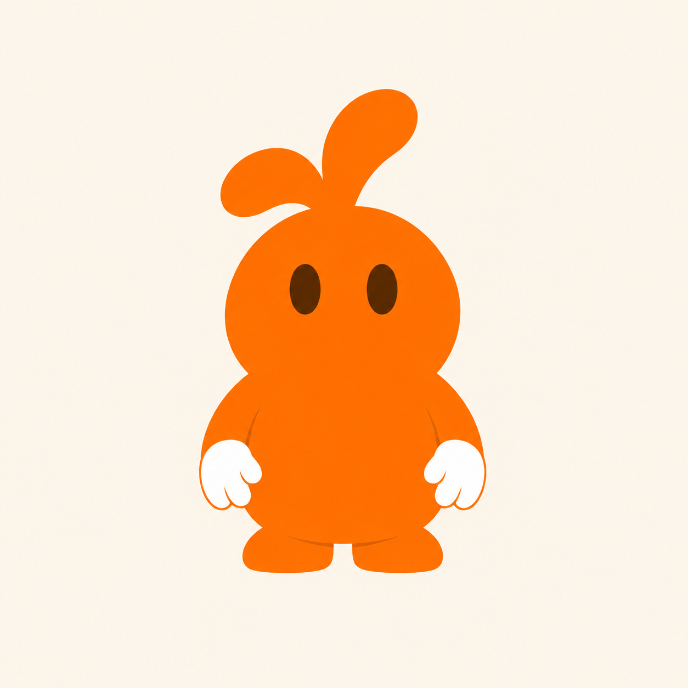
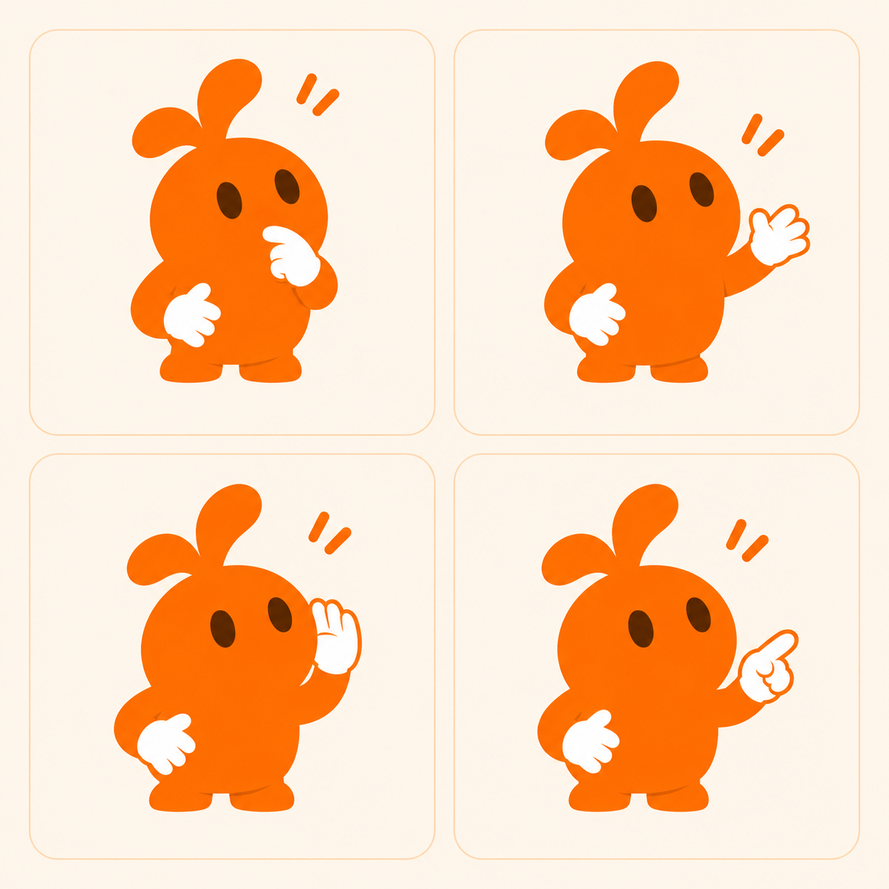
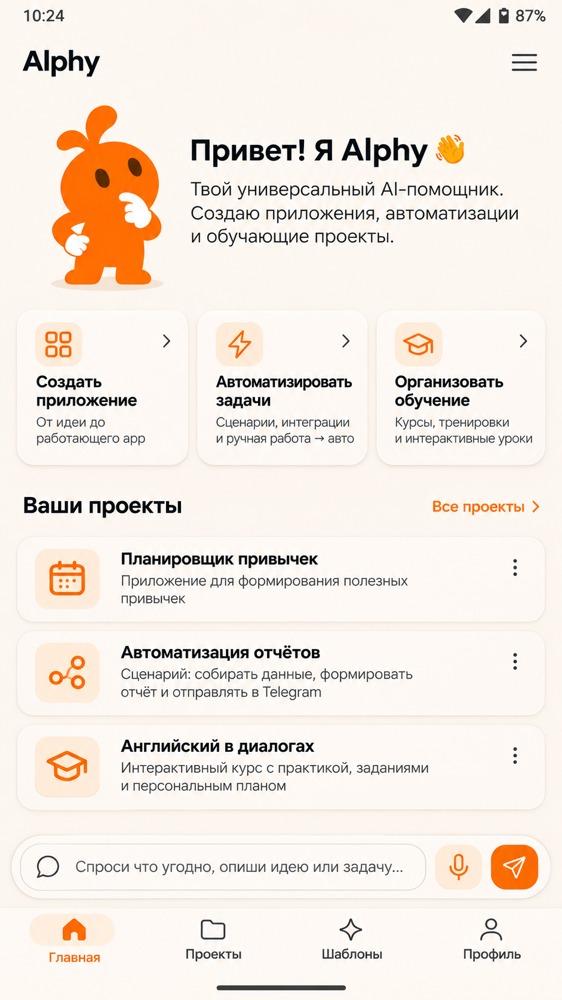
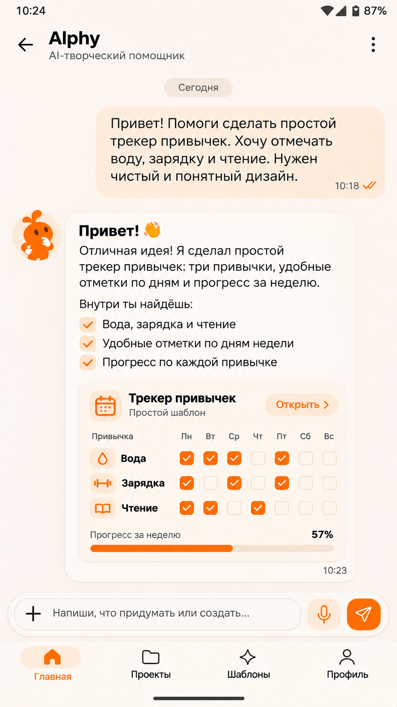
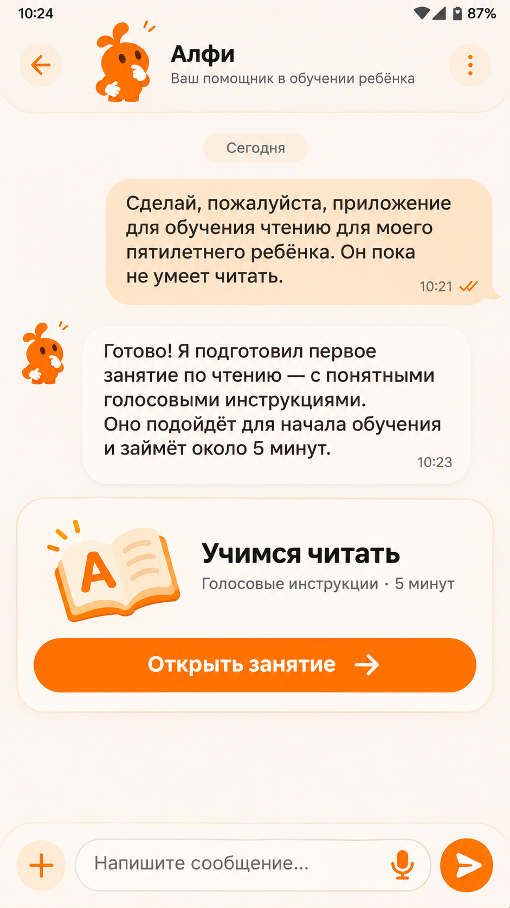
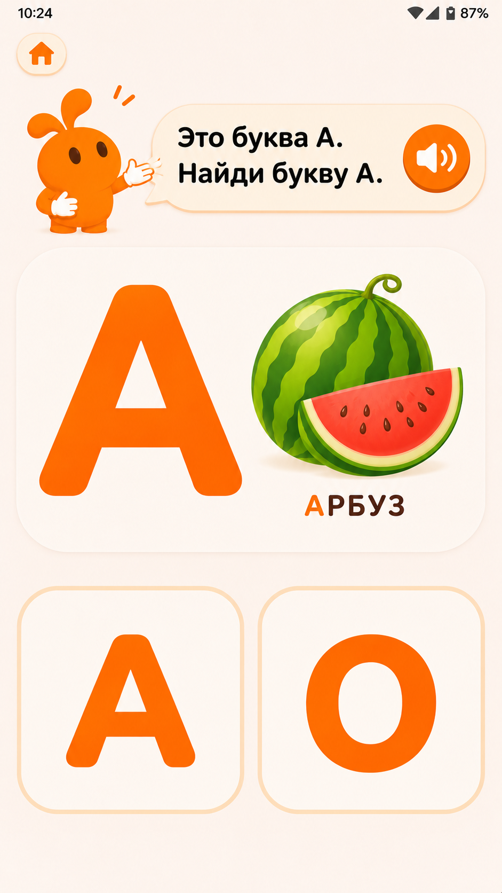

# Alphy character and interface concept

This document records the design direction from the session of November 5, 2026.
The images are concept mockups. They do not show implemented features or final assets.
The existing [Alphy UI design](2026-11-03-alphy-ui-design.md) remains the approved UI specification.
This document does not change that specification. Reconcile any differences before implementation.

## Character identity

Alphy is one orange character with asymmetric ears, dark oval eyes, and white gloves.
The character can change pose and illustration detail to suit the activity.
Its core features remain recognizable in the app and in generated learning experiences.
The user selected the thoughtful character below as the starting point.

### Pose explorations

The front-facing character and the pose sheet are concepts to refine, not final assets.
The sheet explores a thoughtful pose, a greeting, a listening pose, and an explaining pose.
The poses must retain the same character identity and consistent proportions.

## Interface concepts

- **Launcher icon:** Use a simplified Alphy character on a light background. Keep the silhouette clear at small sizes and within Android icon masks.
- **Chat:** Use a compact Alphy avatar beside assistant content. Reserve larger character illustrations for places with sufficient space.
- **Voice:** Use a listening pose during voice interaction. The interface must also show the microphone status clearly and provide a way to stop listening. A pose alone is not sufficient.
- **Learning:** Use an expressive Alphy as a guide. The character can point to an activity and give spoken guidance.
- **Composer:** Place the message form near the bottom for reach. Include text input, a **+** control for media, a microphone control, and a send control.

The home-screen mockup below predates the decision to use **+** for media. Its composer does not show that control.
Its cards and navigation are illustrative and do not establish implemented features.

The chat mockup shows the later **+** media control. The displayed conversation and preview are examples.

## Example: learning to read

This flow is a concept, not an implemented feature or a validated reading curriculum.

1. An adult asks Alphy to create a reading activity for a child who cannot yet read.
2. Alphy presents an activity card. The adult opens the activity from the conversation.
3. Alphy gives a spoken instruction. A speaker control repeats the instruction.
4. The child responds through large visual choices. Reading the instruction is not required.
5. Alphy can give spoken and visible feedback, offer a hint, and continue when the child is ready.

## Open design work

- Refine the character geometry and select the final launcher icon pose.
- Create and test small-size and monochrome icon variants, including Android mask safe areas.
- Define voice states and verify that microphone status and the stop control are clear.
- Reconcile the mockups with the approved UI specification, including its theme and navigation decisions.
- Test the icon, interface, and learning flow with users, including children and their caregivers.
